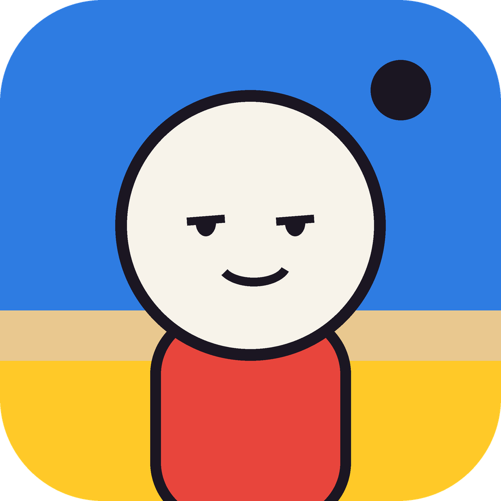
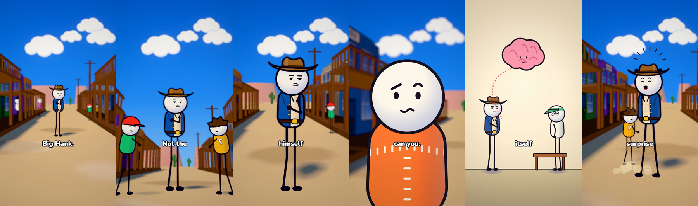
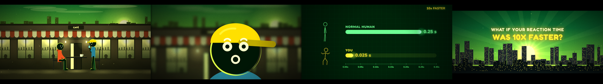

<p align="center"></p>

<h1 align="center">Inkbox Animator</h1>

<p align="center"><b>Turn a voiceover into a finished animated video, right from Claude.</b><br>
Cartoon shorts or cinematic stick-figure explainers, with scenes, camera moves, captions, music and sound effects. Everything is rendered by code.</p>



---

## What it does

Give Claude a voiceover (and optionally a script). Inkbox Animator then:

1. **Times every word** of your narration (Whisper), or reads the timings from your SRT, VTT or timestamped script.
2. **Breaks the story into shots** of 2–3 seconds, with a concrete picture, camera move, transition and sound for each line.
3. **Builds every scene in code**: characters, sets, props, effects and on-screen graphics, invented fresh for your script.
4. **Shows you previews** (contact sheets and short clips) before the long render.
5. **Renders the video frame by frame** and mixes generated music, sound effects and ambience under your voice, normalised to −14 LUFS.

The result is a finished MP4 in **16:9 or 9:16**, at **720p, 1080p, 1440p or 4K**.

No image or video AI is involved. Every frame is drawn by code, so characters never change shape between shots, text stays sharp, and any shot can be fixed and re-rendered exactly.

## Two kinds of looks

### Bright Toon (style `toon`)
Cartoon characters with big round white heads, thick ink outlines, costumes and long stick legs, standing in **sunny 3D sets**:
- Painted storefronts with porches and signs, warm sand, puffy clouds, distant mesas and soft lavender-blue shadows.
- A camera that is always moving, with **depth of field**: the subject stays sharp while the background melts away.
- **Cartoon effects:** sweat drops, shock lines, impact bursts, dust puffs, power-up flames, dizzy stars and motion trails.
- **One-word captions** in heavy white text with a black outline. Short phrases like "in the dirt" stay together.
- Quick crossfades, plus a **zoom-through transition** that dives into a head, an eye or a window for the explanation scene.
- Costume kit: shirts with stitching, vests, suits, dresses, lab coats; cowboy hats, top hats, bowlers, caps, eyeshades; mustaches, glasses, monocles, holsters and belts.
- Expressions include smug, unimpressed, gritted teeth, panic, dazed, power-up eyes and more.

Ideal for "why does this happen?" shorts, comedy explainers and history told as a cartoon.

### Cinematic stickman (five styles)
Black stick figures with glowing rim light in moody 2.5D sets: giant face close-ups, freeze-frame "time stopped" moments, animated numbers and charts, blueprint diagrams and low-poly 3D orbit shots.



| Style | Feel |
|---|---|
| `emerald` (Inkbox Emerald) | Forest-green shadows, gold key light, electric lime rims |
| `ember` (Ember Forge) | Charcoal and crimson, molten copper rims, high contrast |
| `arctic` (Arctic Glass) | Icy steel-teal, crisp white light, cyan rims |
| `sakura` (Sakura Bloom) | Plum shadows, rose sky, peach light, soft haze |
| `retro` (Retro Print) | Faded teal and mustard, heavy print grain |

## Install

**Claude Code**
```text
/plugin marketplace add Ahmed-bel-haj-boubaker/inkbox-animator
/plugin install inkbox-animator@inkbox-animator
```

**Claude app (desktop)**
Download `inkbox-animator.plugin` from the Releases page and open it in Claude, then press **Install**.

## Usage

Just ask in plain words:

| Say | What happens |
|---|---|
| "Make a cartoon video from this voiceover" | Runs the whole pipeline in the Bright Toon look |
| "Make a 2D video from this voiceover" | Runs the whole pipeline (you pick a style along the way) |
| `/new-video` | Sets up the project, times the narration and plans the shots |
| `/video-styles` | Renders your own shots in all six looks so you can compare, or designs a custom look |
| `/render-video` | Builds and checks the scenes, previews, renders the final video |
| `/video-sound` | Music moods, sound effects, ambience and the final mix |

### Inputs and options
- **Voiceover** (required): any common audio format. Inkbox Animator doesn't generate voices, so record your own or use a text-to-speech tool.
- **Script** (optional): timestamped (SRT, VTT, JSON, or TXT with `[mm:ss]`) or plain text (aligned to the audio automatically). With no script, the voiceover is transcribed.
- **Aspect:** 16:9 or 9:16. **Resolution:** 720p, 1080p, 1440p or 4K.
- **Captions:** on or off (on by default for 9:16).
- **Music:** generated by mood (mystery, tension, action, wonder, hopeful, sad, triumph, playful, calm, dark, epic), your own track, or none.
- **Sound effects:** 36 built-in effects and ambience beds, or your own files.

## Requirements

On first use, Claude copies the bundled studio into your project folder (`inkbox-animator-studio/`) and installs what it needs:

- **Node.js 18+** and the npm packages (Playwright renderer, Three.js, fonts)
- A **headless Chromium** (via Playwright)
- **ffmpeg** and ffprobe
- **Python 3.9+** with numpy, scipy and faster-whisper

Allow about 1 GB of disk. Whisper downloads its speech model from huggingface.co on the first transcription. No API keys or accounts are needed.

## Render times

Rendering is frame by frame, so longer and larger videos take longer:

| Machine | Stickman 2D, 720p | Bright Toon 3D, 720p |
|---|---|---|
| 2-core cloud machine, no GPU | ~2 frames/s | ~0.7 frames/s |
| Modern desktop with a GPU | 3–5× faster | much faster (3D benefits most from a GPU) |

1080p takes about 2× as long as 720p, and 4K about 8×. For example, the 26-second Bright Toon sample took 16 minutes at 720p on a 2-core cloud machine. Render long 4K videos overnight.

## Example projects

The studio ships with two complete reference projects:
- `examples/bright-toon`: *Why You Can't Tickle Yourself*, a 26 s vertical cartoon short (3D western street, billboarded characters, depth of field, an "inside the head" metaphor scene, cartoon effects, one-word captions).
- `examples/reaction-time`: *What If Your Reaction Time Was 10x Faster?*, a 47 s stickman explainer (café scenes, giant faces, a 3D orbit, blueprint charts, a title card).

Render a quick contact sheet of either one:
```bash
cd inkbox-animator-studio
node render.mjs --project examples/bright-toon --sheet --scale 0.4
```

## How it works

```text
voiceover ─► word timings (Whisper) ─► story bible + shot list (story/shots.json)
          ─► scene code (2D canvas + Three.js) ─► contact sheets ─► previews
          ─► headless Chromium renders every frame ─► ffmpeg ─► music + SFX mix ─► MP4
```

- `engine/`: shared runtime, character rigs (`rig2d.js` for the stickman look, `toon2d.js` for Bright Toon), effects, UI graphics, the Three.js kit with toon sets and character billboards, styles and the frame player.
- `tools/`: project setup, transcription, script parsing, beat detection and environment checks (`doctor.py`, `verify_kit.py`).
- `audio/`: synthesised music, sound effects and the mixer.

## Plugin contents

```text
.claude-plugin/plugin.json      manifest
skills/make-2d-video/           full pipeline + references + studio kit (kit/)
skills/new-video/               /new-video
skills/video-styles/            /video-styles
skills/render-video/            /render-video
skills/video-sound/             /video-sound
```

## Troubleshooting

- **Fonts look like a plain serif:** run `npm install` inside `inkbox-animator-studio`.
- **"Player failed to boot":** usually a JSON syntax error in `config.json` or `shots.json`, or a wrong import path in a scene file.
- **3D shots are black:** add `--gl swiftshader` and check the console for Three.js errors.
- **Out of memory at 4K:** render with `--workers 1` or `--workers 2`.
- **Transcription is slow:** use `--model base`.
- **Check the install:** `python tools/doctor.py` and `python tools/verify_kit.py`.

## Credits

Inkbox Animator is maintained by **Ahmed Belhaj Boubaker**.

It builds on **GrowKaz Stickman** by GrowKaz, which provided the original stick-figure studio, the rendering engine and the five stickman styles. The Bright Toon look, the 3D cartoon set builders, billboarded characters, depth of field, cartoon effects, one-word captions and the zoom-through transition were added in Inkbox Animator.

## License

License to be confirmed. See the `LICENSE` file once it's added.
